<div align="center">

<!--  -->


<div align="center">


</div>

### `Computer Science Student • DSA Enthusiast • AI/ML Explorer`

<br>

[](https://git.io/typing-svg)

## 🧑‍💻 About Me

<table>
<tr>

<td width="55%" valign="top">

<br>

```cpp
const developer = {
    name: "Nipurn",
    education: "B.Tech CSE",
    
    focus: {
        dsa: true,
        ai_ml: true,
        development: true,
        system design: true        
    },

    languages: {
        primary: "C++",
        others: [
            "Java",
            "Python",
            "JavaScript"
        ]
    },

    currentlyLearning: [
        "Graphs",
        "Dynamic Programming",
        "AI / ML",
        "Backend Development",
        "System Design"
    ],

    goal: "Become Internship & Placement Ready 🚀",

    philosophy:
        "Learn → Build → Improve"
};
```

</td>

<td width="45%" valign="middle">

<div align="center">


### 💭 My Focus

**Problem Solving**

**Practical Development**

**Continuous Learning**

**Building Real Applications**

</div>

</td>

</tr>
</table>

<div align="center">


</div>

## 🧩 DSA Journey

<div align="center">

### `Problem Solving → Pattern Recognition → Implementation → Optimization`

<br>


<br>


<br>


</div>

<br>

<div align="center">


</div>

## ⚔️ Tech Arsenal

<br>

<div align="center">

<table width="90%">

<tr>

<td align="center" width="50%">

### 💻 Programming

<br>


<br>

`C++` • `Java` • `Python` • `JavaScript`

</td>

<td align="center" width="50%">

### 🌐 Web & Backend

<br>


<br>

`HTML` • `CSS` • `React` • `Node.js` • `FastAPI`

</td>

</tr>

<tr>

<td align="center" width="50%">

### 🤖 AI / ML

<br>


<br>

`Machine Learning` • `K-Means` • `RFM`

`Prophet` • `SHAP` • `Data Analysis`

</td>

<td align="center" width="50%">

### 🛠️ Tools & Database

<br>


<br>

`MongoDB` • `MySQL` • `Git` • `GitHub` • `VS Code`

</td>

</tr>

</table>

</div>

<div align="center">


</div>

<!-- ## 📊 GitHub Analytics

<!-- <br>

<div align="center">

<table width="90%">

<tr> -->

<!-- <td align="center" width="50%">

  

</td> -->

<!-- <td align="center" width="50%">



</td>

</tr>

</table>

<br> -->

---

<!-- ## 🏆 GitHub Trophies

<!-- <br>

<div align="center">


</div> -->

<br>

### 📊 GitHub Analytics

<p align="center">
  
  
    
</p>

<br>

<div align="center">


</div>

---
<!--
## 💡 Developer Philosophy

<br>

<div align="center">

### `"Don't just learn technology. Build with it."`

<br>

| 🧠 Learn | 💻 Build | 🐛 Debug | 🔄 Improve |
| :------: | :------: | :------: | :--------: |
| Concepts | Projects | Problems |   Skills   |

</div>

---

## 📌 Quick Snapshot

<div align="center">

<table width="90%">

<tr>

<td align="center">

### 🎓

**B.Tech CSE**

</td>

<td align="center">

### 🧩

**DSA Focused**

</td>

<td align="center">

### 🤖

**AI / ML**

</td>

<td align="center">

### ⚙️

**Backend**

</td>

<td align="center">

### 🚀

**Building**

</td>

</tr>

</table>

</div>
-->

<div align="center">


<!--## 💭 Developer Wisdom

<!-- <br>

> **"Consistency beats intensity."**

<br> -->


</div>

---

<!-- 🤝 CONNECT WITH ME -->

<h2 align="center">
   🔗 Connect With Me 🔗 
</h2>

<table align="center">
  <tr>
    <td align="center" width="200">
      <a href="https://www.linkedin.com/in/nipurn20/">
        
      </a>
      <br><br>
      <a href="https://www.linkedin.com/in/nipurn20/">
        <h3>LinkedIn</h3>
      </a>
      <sub><i>Professional Network</i></sub>
    </td>

  <td align="center" width="200">
      <a href="https://github.com/NipurnCoder">
        
      </a>
      <br><br>
      <a href="https://github.com/NipurnCoder">
        <h3>GitHub</h3>
      </a>
      <sub><i>Code Repository</i></sub>
    </td>

 <td align="center" width="200">
      <a href="mailto:nipurnkumar487@gmail.com">
        
      </a>
      <br><br>
      <a href="mailto:nipurnkumar487@gmail.com">
        <h3>Email</h3>
      </a>
      <sub><i>Direct Contact</i></sub>
    </td>

 <td align="center" width="200">
      <a href="https://www.instagram.com/nipurn_20/">
        
      </a>
      <br><br>
      <a href="https://www.instagram.com/nipurn_20/">
        <h3>Instagram</h3>
      </a>
      <sub><i>Social Updates</i></sub>
    </td>
  </tr>
</table>

<br>

<p align="center">
  <a href="https://www.linkedin.com/in/YOUR_LINKEDIN_USERNAME/">
    
  </a>
  <a href="https://github.com/NipurnCoder">
    
  </a>
  <a href="mailto:YOUR_EMAIL@gmail.com">
    
  </a>
  <a href="https://www.instagram.com/YOUR_INSTAGRAM_USERNAME/">
    
  </a>
</p>

<p align="center">
  <i>✨ Let's connect, collaborate, and build something amazing! ✨</i>
</p>

<div align="center">

</div>

<div align="center">

<!-- ### 🚀 `Learn • Build • Solve • Repeat`

<!--  -->


</div>
